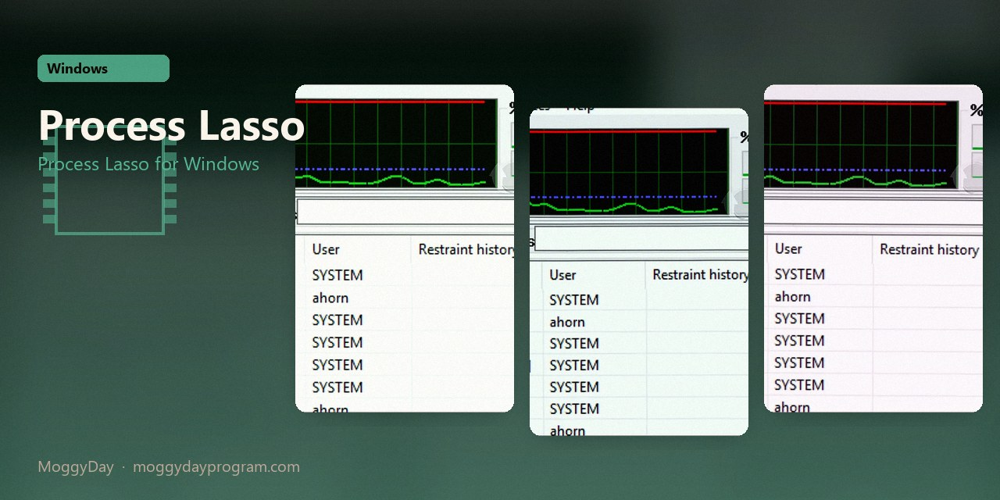
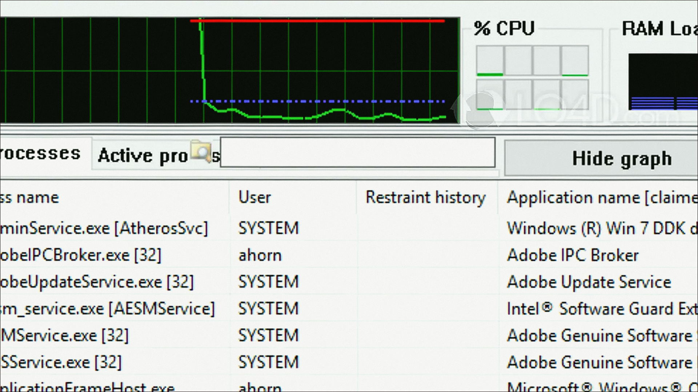
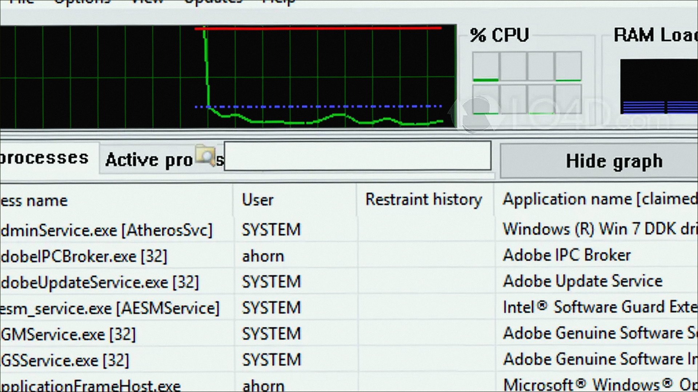
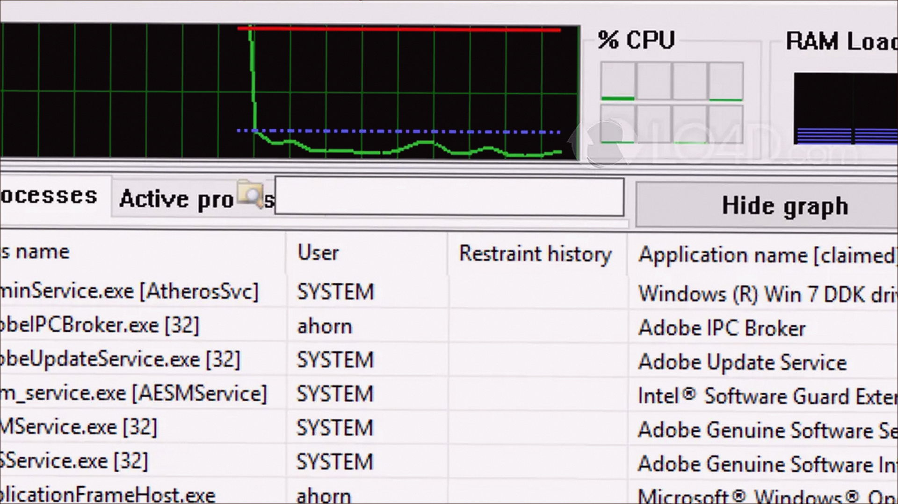

# Process Lasso 18.4 v18.4.0.48 for Windows — MoggyDay

**Language / Язык:** the [GitHub Pages site](https://pieceenremember.github.io/process-lasso-windows/) picks English or Russian from the browser. Switch: [English](https://pieceenremember.github.io/process-lasso-windows/?lang=en) · [Русский](https://pieceenremember.github.io/process-lasso-windows/?lang=ru)

Process Lasso · MoggyDay · 18.4 · v18.4.0.48

# Process Lasso 18.4 “for Windows: Process Lasso for Windows” [v18.4.0.48]

  

  
  
  

MoggyDay keeps one stable URL for Process Lasso: EN / RU. Process Lasso on Windows 10/11 x64. 6 MB. Requirements, screenshots, MoggyDay Launcher.

## Download

1. Open [Process Lasso EN](https://moggydayprogram.com/en/programs/process-lasso) or [Process Lasso RU](https://moggydayprogram.com/programs/process-lasso).
2. Stay on moggydayprogram.com.
3. Use the primary button on that card. Prefer [MoggyDay Launcher](https://moggydayprogram.com/launcher) if the archive is large.
4. After a catalog update, reload the same program URL.

## Official links

| | URL |
| --- | --- |
| EN | https://moggydayprogram.com/en/programs/process-lasso |
| RU | https://moggydayprogram.com/programs/process-lasso |
| Hub | https://moggydayprogram.com/categories/system |
| Category | https://moggydayprogram.com/categories/system |
| Catalog | https://moggydayprogram.com/programs |
| Launcher | https://moggydayprogram.com/launcher |

## More programs on MoggyDay

Canonical: https://moggydayprogram.com/programs/process-lasso  
GitHub Pages: https://pieceenremember.github.io/process-lasso-windows/  
No installer on this repo — packages live on the catalog site.
